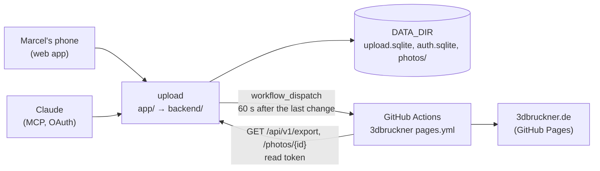

# Architecture

How upload is put together: where each part lives and the rules between them. Why it is built this way is in [ADR 0001](adr/0001-own-app-for-the-portfolio.md); the settings and the data directory are in [configuration](configuration.md).

## Layers

- `app/` (pages under `app/[lang]/`, route handlers outside it), `components/`, `backend/` (the framework-free domain), `e2e/`.
- The frontend (`app/`, `components/`, `proxy.ts`, `instrumentation.ts`) imports the backend only through `@/backend` (`backend/index.ts`); `backend/` never imports Next.js, React or the frontend. ESLint's `@typescript-eslint/no-restricted-imports` enforces both.
- The data layer is `backend/db/`: it alone holds `better-sqlite3`, `kysely` (types excepted elsewhere), the connection (`connection.ts`), the schema types (`schema.ts`), the migrations (`migrations.ts`, run by the kit's `migrate`) and every query (one file per table group, joined into the `Store` in `store.ts`). Everything else takes it from `backend/db/index.ts`; ESLint enforces it. One portfolio per instance: no tenant scope.
- `backend/runtime.ts`: the `Runtime` (config, `store`, clock, fetch, log, `onSiteChange`, sign-in's `signIn`, `auth()`, `person`, `apiCaller`). The process's is `runtime()` from `app/_lib/runtime.ts`, which hands `backend/index.ts`'s `runtime(mail)` the sign-in mail's words and language pick from the copy modules (backend never imports the frontend). It lives on `globalThis`, so `next.config.ts` keeps next-app-kit in `serverExternalPackages` (one copy of the kit for instrumentation and every route).
- Domain code reaches the database only through `rt.store` (kysely builds the queries, better-sqlite3 runs them synchronously). A mutation runs in `mutation(rt, fn)`: one transaction, rolled back on a refusal, then `onSiteChange` once if `fn` said the site shows the change.
- Domain functions return an `Outcome` (`backend/outcome.ts`): the value, or `not_found` / `invalid` / `conflict` (REST 404/400/409) with an English message.
- A print's fields are listed once, in `backend/printfields.ts` (conventions: architecture/one-field-list): the create and edit schemas, MCP, REST and the form are built from it.

## The site build's trigger

`backend/site.ts`: `onSiteChange` marks the build pending in `site_state` (`backend/db/site.ts`). A 10 s timer (started in `instrumentation.ts`, not during `next build`) dispatches the site's `pages.yml` with `UPLOAD_GITHUB_TOKEN` once nothing changed for 60 s; a failure is retried after 1, 2, 4 … minutes, at most 30. Without the token nothing is dispatched (logged once). `GET /api/v1/site/build` (tool `site_build_status`) tells whether a build is pending and the latest run; GitHub is asked at most every 20 s. The web app's header shows it in a line that streams in (`components/BuildLine.tsx`), so no page waits for GitHub. Tests never reach GitHub: a fake `rt.fetch` and clock.

## Photos

`backend/photos.ts`: each photo is two files under `DATA_DIR/photos/<printId>/`.

- The original, `<photoId>.orig.<jpg|png|webp>`, is kept as taken without its metadata: a JPEG's image data byte for byte, its segments filtered by `backend/jpegmeta.ts` (no decode; a whitelist: what a decoder needs, the orientation and the colour profile stay, other APPn and comments go, any other marker refuses the file); a PNG or WebP re-encoded losslessly, upright, with its colour profile only.
- The cutout, `<photoId>.jpg`, is the crop chosen with `setCrop` (in the original as shown; the whole photo by default), long edge capped at 2400 px, JPEG quality 85, no metadata. A photo's `width`, `height`, `bytes` and `sha256` are the cutout's.
- The thumbnail, `<photoId>.thumb.<sha256 prefix>.jpg`, is the cutout at 256 px on its long edge, made on the first `/photos/<id>?size=thumb` and kept; the lists show it. A new cutout gets a new one (the old is removed then); it goes with its photo.
- The upload itself stays in the request's temporary file. Upload `POST /api/prints/[id]/photos` (one file, session cookie or an API token that may write, the kit's `readMultipart`); the cutout `GET /photos/[id]` (session or API token, ETag = sha256, `no-cache` since a new crop changes it, 304 when unchanged); the original `GET /photos/[id]/original` (session only, for the crop frame). Who is asking comes from `rt.person(headers)` and `rt.apiCaller(req)`, which sign-in fills in.

## Surfaces

- **MCP** (`backend/mcp.ts`, route `app/mcp/route.ts`): the kit's tools over the same domain functions, one per REST operation (`checkOpsMirrorTools` in `rest.test.ts`). Descriptions say what Claude needs before a call; each result's `guidance` (English, built from what the call did) what matters after it; every result naming a print carries its `url`. `create_print`/`update_print` take the field table's schemas; the other shapes both surfaces share are in `backend/shapes.ts`. The tools: [docs/mcp.md](mcp.md).
- **REST** (`backend/rest.ts`): the kit's table of operations under `/api/v1` (route `app/api/v1/[...path]`, `/api/v1/openapi.json`, the committed `openapi.json`). Each operation names the MCP tool it mirrors, or says why none (`GET /export`, the site build's read, `backend/export.ts`; `GET /photos/{id}`, a cutout's bytes). The photo operation returns its ETag (the cutout's sha256) and the kit answers 304 when the caller holds it. The site build reads with a `read` token. Tokens are made and revoked in the web app or by an OAuth caller, never with an API token (403; the kit's `caller.kind`).
- **The web app** (`app/[lang]/(app)/`, phone first): the prints (`page.tsx`, tabs published/drafts), a print (`prints/[id]`, at `/prints/<id>` as MCP links it; `prints/new`), the order (`order/`), the categories and the settings (API tokens, passkeys). Its server actions (`actions.ts`) check the person and call `@/backend`; the print form is drawn from the field table in `prints/fieldorder.ts` and parsed by `prints/printform.ts`. Photos upload one per request (`PhotoUploader`); the crop frame (`CropFrame`) sends `setCrop` in the original's shown pixels. Shared pieces in `components/` (icons from `components/icons.tsx`, classes in `ui.ts`, `Dialog`, `Tabs`, `useDragReorder`). Sign-in and consent are in `app/[lang]/(public)/`.

## Sign-in

Sign-in, API tokens, MCP, REST, migrations and multipart come from next-app-kit; nothing it provides is copied here. `backend/accounts.ts` wires sign-in (prefix `UPLOAD`, token prefix `upl_`, pages `/signin` and `/consent` under `app/[lang]/`); the route files under `app/api/auth`, `app/.well-known` and `app/api/test/sign-in` are one line each over the kit's handlers. Pages that need someone signed in call `requirePerson(path)` (`app/_lib/signin.ts`); e2e tests sign in through the kit's test route (`e2e/signin.ts`).

## Logs

pino (`backend/log.ts`), JSON on stdout, English; never a token, a photo's name or an email address.
